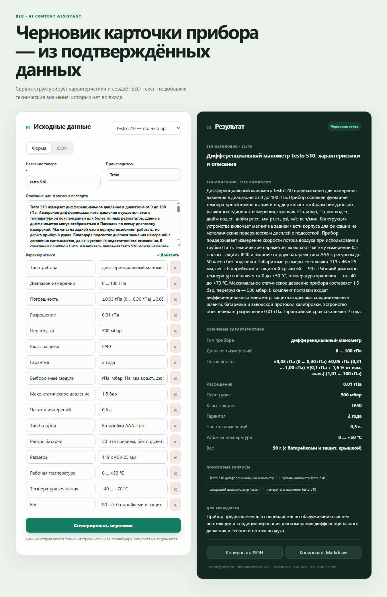

# AI-помощник товарных карточек

MVP для подготовки черновиков B2B-карточек контрольно-измерительных приборов. Сервис принимает подтверждённые данные товара, обращается к OpenAI-compatible LLM и возвращает SEO-текст, ключевые характеристики, поисковые запросы и блок для менеджера.

Главный инвариант: технические значения не придумываются. LLM выбирает только ключи характеристик, а значения backend подставляет дословно из входного `specs`.



## Что реализовано

- FastAPI API с OpenAPI/Swagger.
- React/TypeScript UI с формой и JSON-режимом.
- Статусы `draft_ready` и `needs_clarification`.
- Grounding, проверка длины/структуры и одна корректирующая LLM-попытка.
- OpenAI-compatible HTTP adapter с custom base URL и сетевым proxy.
- Два полных товара и один partial-сценарий.
- Отдельный one-shot `catalog-importer` без HTTP API.
- Docker Compose для backend, frontend и tools-профиля importer.
- Offline unit/component fixtures и smoke-клиент.

## Быстрый запуск через Docker

1. Скопируйте `.env.example` в `.env` и заполните как минимум:

```dotenv
LLM_API_KEY=...
LLM_BASE_URL=https://api.openai.com/v1
LLM_MODEL=...
LLM_HTTP_PROXY_URL=
```

Для proxyapi.ru укажите предоставленные сервисом base URL, ключ и model ID. `LLM_HTTP_PROXY_URL` нужен только для обычного сетевого HTTP(S)-proxy.

2. Запустите:

```powershell
docker compose up --build
```

Для standalone Compose команда эквивалентна:

```powershell
docker-compose up --build
```

После запуска:

- UI: <http://localhost:8080>
- Swagger: <http://localhost:8000/docs>
- Health: <http://localhost:8000/api/v1/health>

Если порты заняты, измените `FRONTEND_PORT` или `BACKEND_PORT` в пользовательском `.env`.

Importer не запускается вместе с приложением. UI сразу получает три сохранённых примера из репозитория; LLM вызывается только после нажатия «Сгенерировать».

## Локальная разработка

Python 3.12:

```powershell
python -m venv .venv
.venv\Scripts\python.exe -m pip install -r requirements-dev.txt
.venv\Scripts\python.exe -m uvicorn backend.app.main:app --reload
```

Frontend в отдельном терминале:

```powershell
cd frontend
npm install
npm run dev
```

Приложение само не открывает `.env`. Для локального backend передайте переменные процессу удобным для вас способом. Реальный `.env` запрещено добавлять в Git.

## Демо-примеры

В UI доступны:

- `testo 510` — полный пример;
- `testo 830-T1` — полный пример;
- `testo 510` partial — только диапазон измерений, без описания.

Partial-пример должен вернуть `needs_clarification` и указать отсутствующее описание.

Повторная подготовка fixtures локально:

```powershell
.venv\Scripts\python.exe -m catalog_importer prepare-examples
```

Через Docker:

```powershell
docker compose --profile tools run --rm catalog-importer prepare-examples
```

Полный базовый YML-индекс без обхода товарных страниц:

```powershell
docker compose --profile tools run --rm catalog-importer index --output /data/catalog.jsonl
```

Найти offer ID и подготовить другой товар:

```powershell
docker compose --profile tools run --rm catalog-importer search --index /data/catalog.jsonl --query "манометр Testo" --limit 20
docker compose --profile tools run --rm catalog-importer enrich --offer-id 58444 --output-dir /workspace/examples/inputs
```

Большой индекс и cache игнорируются Git. `search` работает локально, а обогащение страниц выполняется только для явно переданных offer ID.

## Проверки

Backend и importer:

```powershell
.venv\Scripts\ruff.exe check backend catalog-importer tools
.venv\Scripts\python.exe -m pytest
```

Frontend:

```powershell
cd frontend
npm run typecheck
npm run lint
npm run test
npm run build
```

Live smoke после пользовательского запуска backend с ключом:

```powershell
.venv\Scripts\python.exe tools\smoke_api.py
```

Ответы сохраняются в `examples/outputs/` и не содержат секретов.

## API

Основной endpoint: `POST /api/v1/product-cards/generate`.

```json
{
  "name": "testo 510",
  "manufacturer": "Testo",
  "specs": {
    "Диапазон измерений": "0 ... 100 гПа"
  },
  "description": "Прибор предназначен для измерения..."
}
```

Дополнительно доступны `GET /api/v1/examples` и `GET /api/v1/health`. Полный контракт описан в [docs/api/http-contract.md](docs/api/http-contract.md).

## Принятые решения

- Runtime не ищет сведения в интернете и не переходит по ссылкам из ввода.
- Характеристики формируются детерминированно из `specs`.
- OpenAI-compatible adapter реализован напрямую на `httpx`, без зависимости от provider SDK.
- `catalog-importer` — отдельный CLI/job Compose-профиля `tools`, а не backend endpoint.
- БД, авторизация, история и CMS намеренно не входят в MVP.

## Ограничения и развитие

- Grounding технических литералов снижает риск, но не заменяет инженерную проверку смысла текста.
- Сервис не определяет обязательный набор характеристик для каждой категории товара.
- Нет очереди задач и хранения результатов.
- Native Anthropic/Google adapters можно добавить через существующий `LLMProvider`.
- Web-enrichment потребует доверенных источников, provenance/citations и отдельного ADR.

Архитектура, ADR и пошаговый план находятся в [docs/README.md](docs/README.md).

