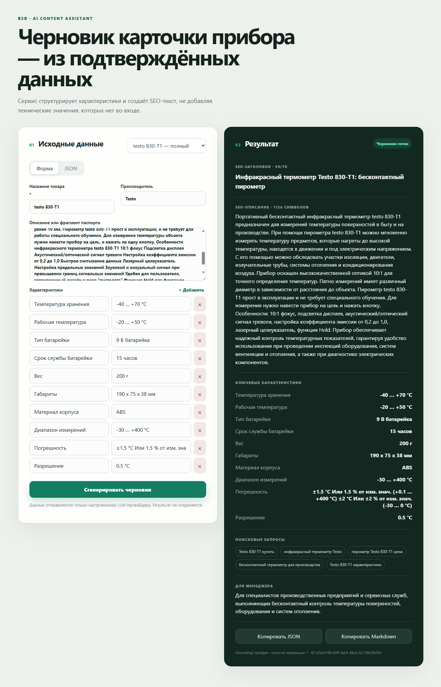

# Первый live-запуск

Дата: 2026-11-05.

Результат Testo 830-T1 до усиления prompt и настройки логирования:

## Наблюдения

- Оба полных товара сформировали требуемые поля и прошли grounding после одной корректирующей попытки.
- Технические значения соответствовали входным fixtures.
- В prose появились допустимые по старому validator, но нежелательные оценочные выводы: «IP40 гарантирует надёжность» и «гарантия подтверждает качество».
- Partial-товар был отправлен в LLM, но обе попытки вернули результат, не прошедший проверку; API корректно не показал непроверенный текст, однако ответ `502` был недостаточно полезен менеджеру.
- Uvicorn access-log печатал health-check каждые 10 секунд, а nginx подробно логировал static assets и User-Agent.

## Принятые изменения

- Prompt запрещает неподтверждённые оценочные и причинно-следственные выводы; характеристики формулируются нейтрально.
- Partial fixture сохраняет тип прибора и несколько подтверждённых характеристик, но остаётся без описания.
- Если неполный товар после одной коррекции не проходит проверку, API возвращает `200 needs_clarification`, `draft: null`, missing fields и инструкции. Для полного товара сохраняется `502`.
- Uvicorn access-log отключён; application logger пропускает успешный health-check.
- Nginx не логирует static/UI-запросы, а API пишет короткую строку без Referrer и User-Agent.
- В importer добавлена локальная команда `search` для выбора offer ID из JSONL-индекса.

## Что означает `retry_count: 1`

Первая генерация нарушила одно или несколько правил структуры/grounding, после чего сервис выполнил единственную разрешённую коррекцию. Непроверенный первый ответ пользователю не возвращается.

